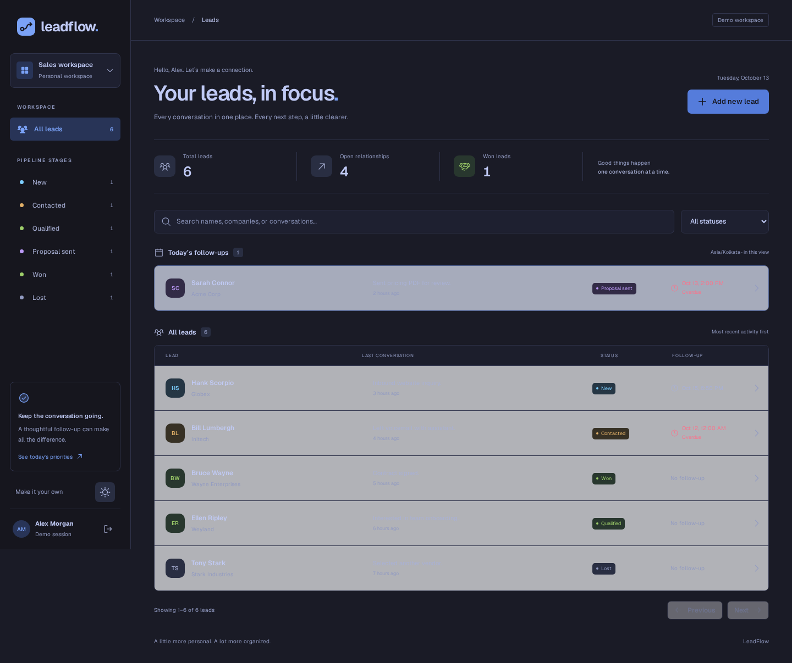

# LeadFlow

A single-screen CRM for leads, discussion history, and follow-up reminders. Built with
Next.js, FastAPI, PostgreSQL, and Solr. Includes a demo sign-in, responsive layouts,
and light/Tokyo Night themes.



## Start everything

Requirements: Docker with Compose v2. Run from this repository root:

```sh
cp .env.example .env  # Skip if .env already exists.
sudo docker compose up --build -d
```

Open **http://localhost:3000**. Enter a name and email to start a demo session.
API Swagger documentation is at **http://localhost:8000/docs**.

Compose starts PostgreSQL 17 Alpine, Solr, database migrations and demo seeding,
FastAPI, the search worker, and the Next.js frontend. The initializer exits successfully;
the other services stay running. All services explicitly share the `backend` bridge network.
Ports 3000, 8000, 5432, and 8983 must be free. Set `WEB_PORT=3001` in `.env` if
3000 is occupied; then open http://localhost:3001. Data persists in named volumes.

The demo sign-in only personalizes the UI; it is not authentication. All demo users share
the same backend data. Run this assessment in a trusted environment.

## Local development

Start the backend with Docker, then run the frontend locally:

```sh
sudo docker compose up --build -d api worker
cd frontend
npm ci
npm run dev
```

Open the Local URL printed by Next.js. If 3000 is occupied, it selects the next available port.
The frontend reads the root `.env`; `API_BASE_URL` defaults to `http://127.0.0.1:8000`.
Browser requests use a same-origin proxy, so changing the frontend port does not require CORS changes.

- [Frontend setup, architecture, and browser tests](docs/frontend.md)
- [Backend setup, API contract, migrations, and integration tests](docs/backend.md)
- [Screenshots of the working application](docs/screenshots/)

## Main workflows

- Add leads with name, optional company, and phone.
- Search names, companies, phone numbers, and discussion history.
- Filter every pipeline stage and paginate server-side.
- Pin today's follow-ups and highlight overdue reminders in red.
- Open a lead dialog, read newest-first history, and load older discussions.
- Save discussions with optional date/time, update status, and clear reminders.
- Switch light/dark mode; theme survives reload, demo session stays in the browser tab.

## Architecture

```text
frontend/src/
  app/                   Next.js routes and server-side API proxy
  features/
    auth/                Demo session and sign-in
    leads/               Typed API adapter, query hooks, forms, list
    discussions/         Timeline, pagination, discussion form
    workspace/           Layout, filters, selection, pagination state
  components/ui/         Shared accessible primitives
  providers/             Query client, theme, shared clock/timezone
  lib/                   HTTP interface, errors, date utilities
  styles/                Theme tokens and small stylesheets
backend/src/leadflow/
  core/                  Configuration, database sessions, errors, health
  features/              Leads, discussions, and search modules
  scripts/               Seed and reindex commands
```

Frontend components render UI, query hooks manage server state, and API adapters implement
requests through a small injected HTTP interface. Zustand owns workspace UI state and the
explicit demo session. PostgreSQL remains authoritative; a transactional outbox synchronizes
Solr asynchronously.

## Verification

```sh
cd frontend
npm run typecheck
npm run lint
npm test
npm run build
```

Browser tests and real-service test instructions are in the linked guides. Tests distinguish
mocked UI workflows from real PostgreSQL/Solr integration; a passing mocked test does not
replace real-service verification.

## Design and AI usage

Implemented with Codex assistance, including architecture, application code, and tests.
The requested `Leonxlnx/taste-skill` package was installed; its `minimalist-ui` guidance
informed the layout. Installation provenance is recorded in `skills-lock.json`; local skill
files are ignored. Dark theme colors follow the official
[Tokyo Night palette](https://github.com/folke/tokyonight.nvim/blob/main/extras/lua/tokyonight_night.lua).
Icons use Phosphor and the Geist font is self-hosted through Fontsource.
