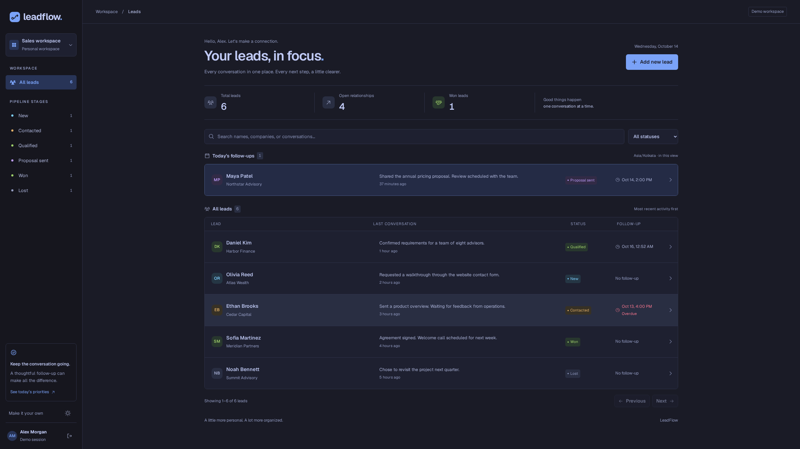
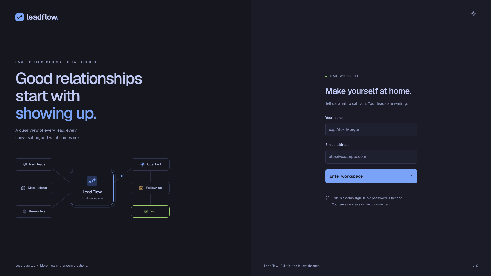
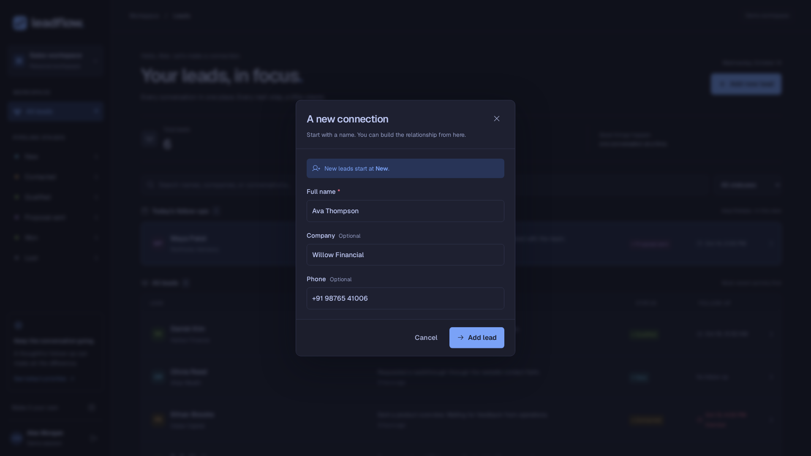
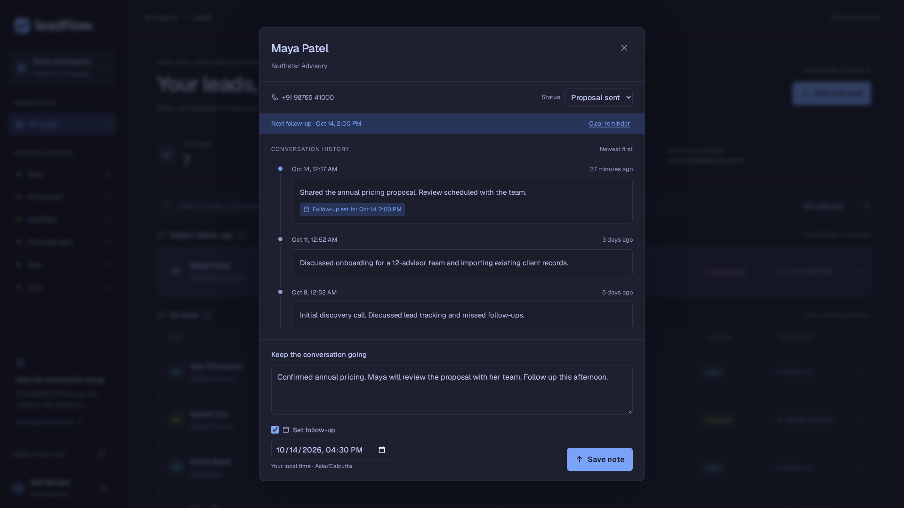
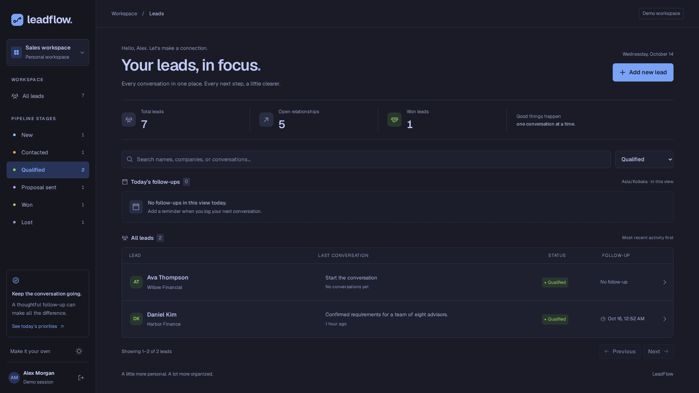
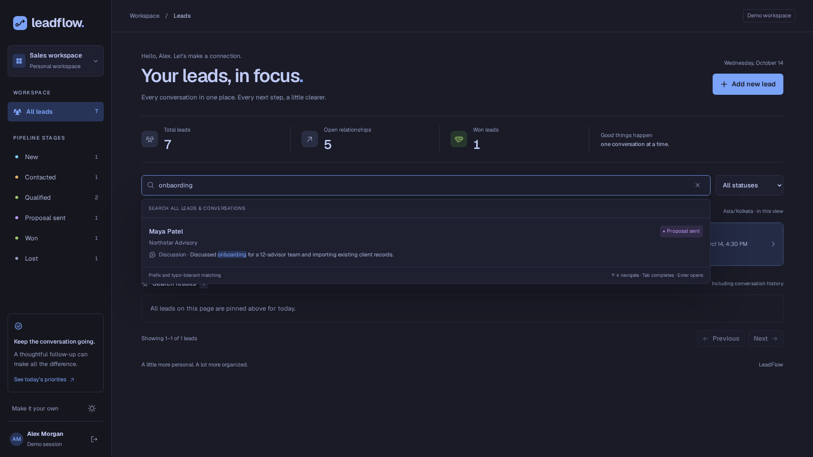
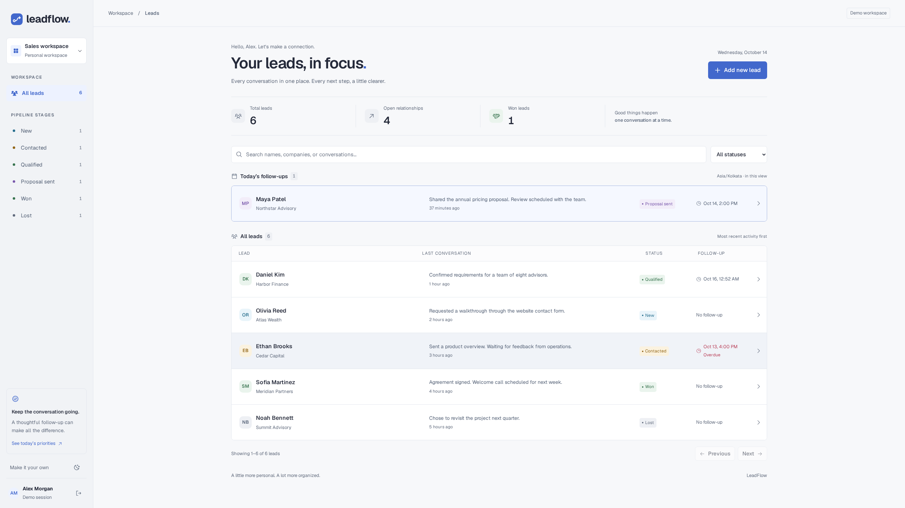

<h1 align="center">LeadFlow</h1>

<p align="center">
  A single-screen CRM for leads, conversations, and follow-ups.
</p>

<p align="center">
  
  
  
  
  
</p>

<p align="center">
  <a href="#features">Features</a> ·
  <a href="#getting-started">Getting started</a> ·
  <a href="#usage-scenarios">Usage</a> ·
  <a href="#architecture">Architecture</a> ·
  <a href="#testing">Testing</a>
</p>

## Features

- **Lead management:** create leads, filter six pipeline stages, and view latest notes and activity times.
- **Discussion history:** newest-first timelines, status updates, and immediate list refresh after saving.
- **Follow-ups:** date/time reminders, today's priorities pinned first, and overdue reminders in red.
- **Search:** Solr fuzzy matching across names, companies, phones, and discussions, with autocomplete and excerpts.
- **Interface:** responsive layouts, skeleton loading, demo sign-in, and light/Tokyo Night themes.
- **Setup:** Docker Compose, automatic migrations, demo seeding, versioned APIs, and OpenAPI documentation.

## Getting started

Requires Docker and Compose v2. From the repository root:

```sh
cp .env.example .env
sudo docker compose up --build -d
```

Keep your existing `.env` if one is already configured. Compose applies migrations,
seeds six leads and twelve discussions, and starts the frontend, API, database, and search worker.

| Service | Address |
| --- | --- |
| Application | http://localhost:3000 |
| Swagger UI | http://localhost:8000/docs |
| ReDoc | http://localhost:8000/redoc |
| OpenAPI JSON | http://localhost:8000/openapi.json |

Ports `3000`, `8000`, `5432`, and `8983` must be free. Set `WEB_PORT=3001` in `.env`
if port 3000 is occupied. All variables are listed in [.env.example](.env.example).

Stop with `sudo docker compose down`. Database and search data remain in named volumes.

## Usage scenarios

All images below are fresh **16:9** captures of the current interface.
[Capture details](docs/screenshots/readme/README.md) describe the scenario data.

**Review the pipeline.** Maya's reminder is pinned for today; Ethan's overdue follow-up
is highlighted. Each lead shows its company, latest discussion, status, and next action.



<details>
<summary>Demo sign-in and CRM workflow</summary>

Enter a name and email to personalize the workspace. The animated diagram shows leads,
discussions, and reminders flowing through the CRM.



</details>

<details>
<summary>Create a new lead</summary>

Add Ava Thompson from Willow Financial. Company and phone are optional; status starts at New.



</details>

<details>
<summary>Log a discussion and schedule a follow-up</summary>

Open Maya's timeline, review earlier conversations, and record the pricing discussion
with a 4:30 PM reminder. Saving updates the history, lead summary, and active reminder.



[View the saved discussion and updated reminder](docs/screenshots/readme/07-saved-discussion.png).

</details>

<details>
<summary>Update status and filter the pipeline</summary>

Move Ava to Qualified, reload, and filter to qualified leads. The updated status persists.



</details>

<details>
<summary>Find a lead through an older discussion</summary>

Search for `onbaording`. Autocomplete surfaces Maya's earlier onboarding conversation,
even though her latest note is about pricing. Enter opens the matching lead's timeline.



This search UI capture uses a fixed demo API response. Real Solr behavior is covered by
[separate integration tests](docs/backend.md#tests).
[View the opened timeline](docs/screenshots/readme/10-search-to-timeline.png).

</details>

<details>
<summary>Switch to light mode</summary>

Theme preference persists across reloads. Reduced-motion preferences are respected.



</details>

## Architecture

A feature-based modular monolith. Backend routes, services, repositories, and schemas
have separate responsibilities. The frontend uses matching feature boundaries.

| Layer | Tools |
| --- | --- |
| Frontend | Next.js, React, TypeScript, TanStack Query, Zustand |
| Backend | FastAPI, Python, uv, Pydantic |
| Persistence | PostgreSQL, SQLAlchemy, Alembic |
| Search | Apache Solr, transactional outbox worker |
| UI | CSS theme tokens, Geist, Phosphor, Radix Dialog |

PostgreSQL is authoritative. Writes and indexing events commit together; the worker
updates Solr asynchronously. Search results may briefly lag behind a saved discussion.

```text
backend/src/leadflow/features/   leads, discussions, search
backend/migrations/             versioned upgrades and downgrades
frontend/src/features/          auth, leads, discussions, search, workspace
frontend/src/components/        shared UI and illustrations
docs/                           setup guides and screenshots
```

[Backend and API reference](docs/backend.md) · [Frontend and local development](docs/frontend.md)

## Testing

Local checks require Python 3.12+, uv, and Node.js 22+. Run each block from the repository root.

**Backend**

```sh
cd backend
uv sync --frozen
uv run pytest -q
```

**Frontend**

```sh
cd frontend
npm ci
npm run typecheck
npm run lint
npm test
npm run build
```

Fast backend tests use SQLite and fake search adapters. Real PostgreSQL/Solr tests use
[compose.test.yaml](compose.test.yaml) and dedicated test connection variables.
See [integration setup](docs/backend.md#tests) and [browser test setup](docs/frontend.md#browser-tests).

## Demo scope

The sign-in personalizes the UI; it does not authenticate users. Demo users share backend
data. Reminders appear in the app and do not send email or SMS.

## AI usage

Codex assisted with architecture, implementation, tests, and documentation.
UI direction used `Leonxlnx/taste-skill` guidance and the Tokyo Night palette.
